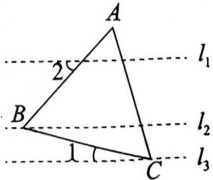

如图，直线 $l_{1} \parallel l_{2} \parallel l_{3}$，等边三角形 ABC 的顶点 B, C 分别在直线 $l_{2}, l_{3}$ 上．若边 BC 与直线 $l_{3}$ 的夹角 $\angle 1 = 25^{\circ}$，则边 AB 与直线 $l_{1}$ 的夹角 $\angle 2$ 等于（）.

第 6 题图 

(A) $25^{\circ}$
(B) $30^{\circ}$
(C) $ 45^{\circ}$
(D) $ 35^{\circ}$

> [!question]- 点击查看答案与解析
> 【答案】(D)
> 
> 【考点】平行线性质、等边三角形 → [[【初中数学知识点体系-人教版】#7-2 平行线]]
> 
> 【解析】
> 因为 $\triangle ABC$ 是等边三角形，所以 $\angle ABC = 60^\circ$。
> 因为 $l_2 \parallel l_3$，根据平行线的性质，内错角相等，$\angle 1 = 25^\circ$ 等于 BC 与 $l_2$ 的夹角。
> 所以 AB 与 $l_2$ 的夹角为 $60^\circ - 25^\circ = 35^\circ$。
> 因为 $l_1 \parallel l_2$，所以 AB 与 $l_1$ 的夹角 $\angle 2$ 等于 AB 与 $l_2$ 的夹角（内错角相等）。
> 因此 $\angle 2 = 35^\circ$。
> 
> 【易错点】不能利用平行线传递角度关系；忽略等边三角形每个内角为 $60^\circ$ 的性质。
