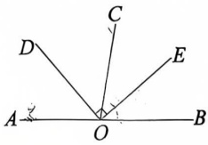

如图，O 为直线 AB 上一点，OE 平分 $\angle BOC$，$OD \perp OE$ 于点 O。若 $\angle BOC = 80^\circ$，则 $\angle AOD =$ ___ 。

第 8 题图 

> [!question]- 点击查看答案与解析
> 【答案】$50^\circ$
> 
> 【考点】角平分线、垂直、平角 → [[【初中数学知识点体系-人教版】#7-1 相交线]]
> 
> 【解析】
> 因为 OE 平分 $\angle BOC$，$\angle BOC = 80^\circ$，所以 $\angle BOE = \frac{1}{2} \times 80^\circ = 40^\circ$。
> 因为 $OD \perp OE$，所以 $\angle DOE = 90^\circ$。
> 因为 O 在直线 AB 上，所以 $\angle AOB = 180^\circ$（平角）。
> $\angle AOD + \angle DOE + \angle BOE = 180^\circ$，
> 即 $\angle AOD + 90^\circ + 40^\circ = 180^\circ$，
> 所以 $\angle AOD = 180^\circ - 130^\circ = 50^\circ$。
> 
> 【易错点】不能正确利用平角为 $180^\circ$ 建立方程；忽略角平分线将角分成相等的两部分。
