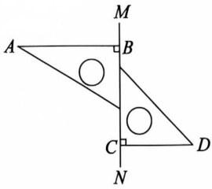

先画一条直线 MN，然后按如图所示的方式摆放三角尺，得到 $AB \parallel CD$，依据是 ___

第 9 题图 

> [!question]- 点击查看答案与解析
> 【答案】同位角相等，两直线平行
> 
> 【考点】平行线判定（同位角） → [[【初中数学知识点体系-人教版】#7-2 平行线]]
> 
> 【解析】
> 用三角尺画平行线的原理：
> 第一次放置三角尺，沿一边画直线；然后沿直线 MN 平移三角尺，再沿同一边画直线。
> 两次画线时，三角尺与 MN 形成的角是同位角且相等，根据"同位角相等，两直线平行"，得到 $AB \parallel CD$。
> 
> 【易错点】不能理解实际操作背后的几何原理；混淆平行线的判定定理。
