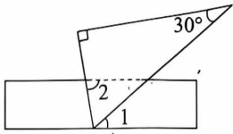

将直尺与含 $30^{\circ}$ 角的三角尺按如图所示的方式叠放在一起，若 $\angle 1 = 40^{\circ}$，则 $\angle 2 =$ ___ 。

第 10 题图 

> [!question]- 点击查看答案与解析
> 【答案】$70^\circ$
> 
> 【考点】平行线性质、三角形外角 → [[【初中数学知识点体系-人教版】#7-2 平行线]]
> 
> 【解析】
> 直尺的两边平行，设直尺上下两边分别为 $l_1$、$l_2$。
> 三角尺含 $30^\circ$ 角，另一个锐角为 $60^\circ$。
> $\angle 1 = 40^\circ$，由对顶角相等，三角尺与直尺交点处的对顶角也为 $40^\circ$。
> 由三角形外角性质，$\angle 2 = \angle 1 + 30^\circ = 40^\circ + 30^\circ = 70^\circ$。
> （或由平行线性质，内错角相等，再结合三角形内角和推导）
> 
> 【易错点】不能正确识别 $\angle 1$ 和 $\angle 2$ 的位置关系；忽略三角尺的角度特征。
