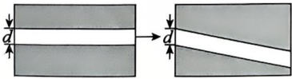

如图，在一块长方形草地上原有一条等宽的笔直小路，现在要把这条小路改为斜向的等宽小路，在入口处宽度不变，则改造后小路的长度___，草地部分的面积___ .（填“变大”“不变”或“变小”）

第 11 题图 

> [!question]- 点击查看答案与解析
> 【答案】变大；不变
> 
> 【考点】平移性质 → [[【初中数学知识点体系-人教版】#7-4 平移]]
> 
> 【解析】
> 小路等宽，入口处宽度不变。
> - 改造前：小路是长方形，长度等于长方形的宽。
> - 改造后：小路是平行四边形，宽度（高）不变，但斜边大于直角边，所以小路长度变大。
> - 草地面积：无论小路是笔直还是斜向，小路占据的面积 = 宽度 × 长方形的长，保持不变。因此草地面积 = 长方形总面积 - 小路面积，也不变。
> 
> 【易错点】误认为斜向小路会改变草地面积；不理解平移变换不改变面积的性质。
