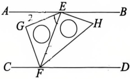

已知 $AB \parallel CD$，一副三角尺按如图所示的方式放置，$\angle AEG = 20^{\circ}$，则 $\angle HFD =$ ___ 。

第 12 题图 

> [!question]- 点击查看答案与解析
> 【答案】$35^\circ$
> 
> 【考点】平行线性质、三角尺角度 → [[【初中数学知识点体系-人教版】#7-2 平行线]]
> 
> 【解析】
> 一副三角尺：一个含 $30^\circ$、$60^\circ$、$90^\circ$，另一个含 $45^\circ$、$45^\circ$、$90^\circ$。
> 由图可知，$\angle AEG = 20^\circ$，含 $30^\circ$ 的三角尺中 $\angle GEF = 60^\circ$。
> 则 $\angle AEF = \angle AEG + \angle GEF = 20^\circ + 60^\circ = 80^\circ$。
> 因为 $AB \parallel CD$，根据平行线的性质，同旁内角互补，
> $\angle AEF + \angle EFC = 180^\circ$，所以 $\angle EFC = 180^\circ - 80^\circ = 100^\circ$。
> 三角尺 HFD 中，$\angle HFC = 90^\circ$（直角），
> $\angle HFD = 180^\circ - \angle EFC - \angle HFC = 180^\circ - 100^\circ - 45^\circ = 35^\circ$。
> 
> 【易错点】不能正确识别三角尺的角度；平行线性质应用错误；角度关系推导混乱。
