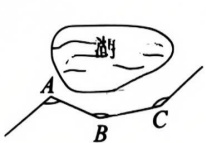

如图，一条公路修到湖边时，需拐弯绕湖而过，如果第一次拐弯的 $\angle A$ 是 $120^{\circ}$，第二次拐弯的 $\angle B$ 是 $150^{\circ}$，第三次拐弯的角是 $\angle C$，这时，公路恰好和第一次拐弯之前的公路平行，则 $\angle C =$ ___ 。

第 13 题图 

> [!question]- 点击查看答案与解析
> 【答案】$150^\circ$
> 
> 【考点】平行线性质、辅助线 → [[【初中数学知识点体系-人教版】#7-2 平行线]]
> 
> 【解析】
> 设第一次拐弯前的公路方向为直线 $l$，第三次拐弯后的公路方向为直线 $l'$。
> 由题意，$l \parallel l'$。
> 过点 B 作 $BM \parallel l$，则 $BM \parallel l'$。
> 因为 $l \parallel BM$，所以 $\angle ABM = \angle A = 120^\circ$（内错角相等）。
> $\angle MBC = \angle ABC - \angle ABM = 150^\circ - 120^\circ = 30^\circ$。
> 因为 $BM \parallel l'$，所以 $\angle MBC + \angle C = 180^\circ$（同旁内角互补）。
> 所以 $\angle C = 180^\circ - 30^\circ = 150^\circ$。
> 
> 【易错点】不会作辅助线；不能利用平行线的性质传递角度关系。
