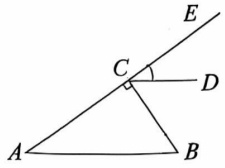

如图，$BC \perp AE$ 于点 C，$CD \parallel AB$，$\angle B = 55^\circ$，求 $\angle DCE$ 的度数。

> [!question]- 点击查看答案与解析
> 【答案】$35^\circ$
> 
> 【考点】平行线性质、垂直、三角形内角和 → [[【初中数学知识点体系-人教版】#7-2 平行线]]
> 
> 【解析】
> 因为 $BC \perp AE$，所以 $\angle ACB = 90^\circ$。
> 在 $\triangle ABC$ 中，$\angle B = 55^\circ$，$\angle ACB = 90^\circ$，
> 所以 $\angle A = 180^\circ - 90^\circ - 55^\circ = 35^\circ$。
> 因为 $CD \parallel AB$，根据平行线的性质，同位角相等，
> 所以 $\angle DCE = \angle A = 35^\circ$。
> 
> 【易错点】不能利用平行线的性质将 $\angle DCE$ 与 $\angle A$ 建立联系；三角形内角和计算错误。
