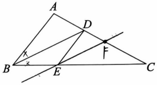

如图, BD 平分 $\angle ABC$ 交 AC 于点 D, $DE \parallel AB$ 交 BC 于点 E, 过点 E 作 $E \parallel BD$ 交 AC 于点 F.

(1) 依据题意补全图形；
(2) 求证: EF 平分 $\angle CED$.

> [!question]- 点击查看答案与解析
> 【答案】(1) 补全图形：过点 E 作 $EF \parallel BD$ 交 AC 于点 F；(2) 证明见解析
> 
> 【考点】角平分线、平行线性质 → [[【初中数学知识点体系-人教版】#7-2 平行线]]
> 
> 【解析】
> (1) 过点 E 作 $EF \parallel BD$，交 AC 于点 F，补全图形。
> 
> (2) 证明：
> 因为 BD 平分 $\angle ABC$，所以 $\angle ABD = \angle CBD$。
> 因为 $DE \parallel AB$，所以 $\angle ABD = \angle BDE$（内错角相等）。
> 因为 $EF \parallel BD$，所以 $\angle BDE = \angle DEF$（内错角相等），
> 且 $\angle CBD = \angle CEF$（同位角相等）。
> 所以 $\angle ABD = \angle BDE = \angle DEF$，
> 且 $\angle ABD = \angle CBD = \angle CEF$。
> 因此 $\angle DEF = \angle CEF$，
> 即 EF 平分 $\angle CED$。
> 
> 【易错点】不能正确利用多组平行线传递角度关系；证明过程逻辑不严密。
