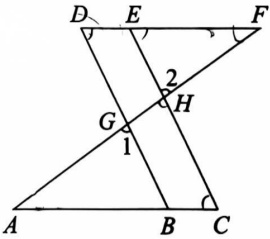

如图，$\angle 1 = \angle 2$，$\angle C = \angle D$，判断 $\angle A$ 与 $\angle F$ 的关系，并说明理由。

> [!question]- 点击查看答案与解析
> 【答案】$\angle A = \angle F$
> 
> 【考点】平行线判定与性质 → [[【初中数学知识点体系-人教版】#7-2 平行线]]
> 
> 【解析】
> 因为 $\angle 1 = \angle 2$，且 $\angle 2$ 和 $\angle 3$ 是对顶角（设 $\angle 2$ 的对顶角为 $\angle 3$），所以 $\angle 2 = \angle 3$。
> 因此 $\angle 1 = \angle 3$。
> 根据同位角相等，两直线平行，所以 $BD \parallel CE$。
> 因为 $BD \parallel CE$，所以 $\angle C = \angle ABD$（同位角相等）。
> 又因为 $\angle C = \angle D$，所以 $\angle D = \angle ABD$。
> 根据内错角相等，两直线平行，所以 $AC \parallel DF$。
> 因为 $AC \parallel DF$，所以 $\angle A = \angle F$（内错角相等）。
> 
> 【易错点】不能通过 $\angle 1 = \angle 2$ 正确判定平行线；多步推理中逻辑链条断裂。
