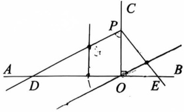

如图，O 为直线 AB 上一点，$OC \perp AB$ 于点 O。点 P 为射线 OC 上一点，从点 P 引两条射线分别交直线 AB 于点 D，E（点 D 在点 O 左侧，点 E 在点 O 右侧），过点 O 作 $OF \parallel PD$ 交 PE 于点 F，G 为线段 PD 上一点，过点 G 作 $GM \perp AB$ 于点 M。

(1) $①$ 依题意补全图形；$②$ 若 $\angle DPO=63^{\circ}$，求 $\angle EOF$的度数；

(2) 用等式表示 $\angle EOF$ 与 $\angle PGM$ 之间的数量关系，并直接写出结果.

> [!question]- 点击查看答案与解析
> 【答案】(1) $②$ $27^\circ$；(2) $\angle PGM = \angle EOF + \angle DPO$
> 
> 【考点】平行线性质、垂直 → [[【初中数学知识点体系-人教版】#7-1 相交线]]
> 
> 【解析】
> (1) $①$ 补全图形：过 O 作 $OF \parallel PD$ 交 PE 于 F，在 PD 上取点 G，过 G 作 $GM \perp AB$ 于 M。
> 
> $②$ 因为 $OC \perp AB$，所以 $\angle POD = 90^\circ$。
> 在 $\triangle POD$ 中，$\angle POD = 90^\circ$，$\angle DPO = 63^\circ$，所以 $\angle PDO = 180^\circ - 90^\circ - 63^\circ = 27^\circ$。
> 因为 $OF \parallel PD$，所以 $\angle EOF = \angle PDO = 27^\circ$（同位角相等）。
> 
> (2) 因为 $GM \perp AB$，$OC \perp AB$，所以 $GM \parallel OC$。
> 因为 $OF \parallel PD$，所以 $\angle EOF$ 与 $\angle PDO$ 是同位角。
> 因为 $GM \parallel OC$，所以 $\angle PGM = \angle DPO + \angle PDO$。
> 又因为 $\angle EOF = \angle PDO$，
> 所以 $\angle PGM = \angle DPO + \angle EOF$，
> 即 $\angle EOF = \angle PGM - \angle DPO$。
> 
> 【易错点】复杂图形中不能正确识别平行线间的角度关系；多组平行线和垂线交织时逻辑混乱。
