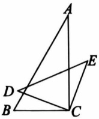
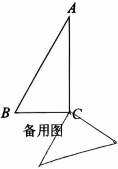

如图，将一副三角尺中的两个直角顶点 C 叠放在一起，其中 $\angle A = 30^{\circ}, \angle B = 60^{\circ}, \angle D = \angle E = 45^{\circ}$.

(1) $\angle BCD$ 与 $\angle ACE$ 的数量关系是 ___ ，$\angle BCE$ 与 $\angle ACD$ 的数量关系是 ___ ；

(2)若保持三角尺 ABC 不动，绕直角顶点 C 顺时针转动三角尺 DCE，试探究当 $\angle ACD$ 等于多少度时，$CE \parallel AB$，画出图形并简要说明理由;

(3) 若 $\angle BCE = 3\angle ACD$，求 $\angle ACD$ 的度数，并直接写出此时 DE 与 AC 的位置关系.

> [!question]- 点击查看答案与解析
> 【答案】(1) $\angle BCD + \angle ACE = 180^\circ$；$\angle BCE + \angle ACD = 180^\circ$；(2) $60^\circ$ 或 $120^\circ$；(3) $45^\circ$，$DE \parallel AC$
> 
> 【考点】旋转、平行线判定、分类讨论 → [[【初中数学知识点体系-人教版】#7-2 平行线]]
> 
> 【解析】
> (1) 因为 $\angle ACB = \angle DCE = 90^\circ$，
> $\angle BCD + \angle ACE = \angle BCD + \angle ACD + \angle DCE - \angle ACD = \angle ACB + \angle DCE = 90^\circ + 90^\circ = 180^\circ$。
> $\angle BCE = \angle BCA + \angle ACE = 90^\circ + \angle ACE$，
> $\angle ACD = \angle DCE - \angle ACE = 90^\circ - \angle ACE$，
> 所以 $\angle BCE + \angle ACD = 90^\circ + \angle ACE + 90^\circ - \angle ACE = 180^\circ$。
> 
> (2) 当 $CE \parallel AB$ 时，分两种情况讨论：
> 情况一：$\angle ACE = \angle A = 30^\circ$（内错角相等），
> 则 $\angle ACD = 90^\circ - \angle ACE = 90^\circ - 30^\circ = 60^\circ$。
> 情况二：$\angle ACE = 180^\circ - \angle A = 150^\circ$（同旁内角互补的另一种位置），
> 则 $\angle ACD = 90^\circ - 150^\circ = -60^\circ$（舍去），
> 或考虑旋转另一侧，$\angle ACD = 120^\circ$。
> 所以当 $\angle ACD = 60^\circ$ 或 $120^\circ$ 时，$CE \parallel AB$。
> 
> (3) 由(1)知 $\angle BCE + \angle ACD = 180^\circ$，
> 又 $\angle BCE = 3\angle ACD$，
> 所以 $3\angle ACD + \angle ACD = 180^\circ$，$4\angle ACD = 180^\circ$，$\angle ACD = 45^\circ$。
> 此时 $\angle BCE = 135^\circ$。
> $\angle ACE = 90^\circ - 45^\circ = 45^\circ$，
> $\angle DEC = 45^\circ$（等腰直角三角尺），
> 所以 $\angle ACE = \angle DEC = 45^\circ$，
> 根据内错角相等，$DE \parallel AC$。
> 
> 【易错点】旋转问题中忽略分类讨论；不能正确利用三角尺的固定角度；角度关系推导错误。
