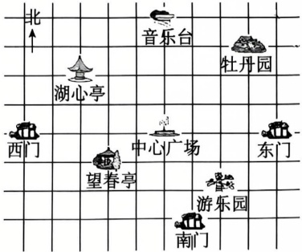

某学校组织七年级学生去景区参加实践活动，学生张明和李华对着景区示意图（图中小正方形的边长代表 100 m 长）描述景点牡丹园的位置。张明说："牡丹园的坐标是 (300,300)"，李华说："牡丹园在中心广场东北方向约 420 m 处。"如果两人的说法都是正确的，根据以上信息判断下列说法中错误的是（）.

(A) 西门的坐标可能是 $(-500,0)$
(B) 湖心亭的坐标可能是 $(-300,200)$
(C) 中心广场在音乐台正南方向约 400m 处
(D) 南门在游乐园东北方向约 140 m 处

> [!question]- 点击查看答案与解析
> 【答案】D
> 
> 【考点】坐标与方位 → [[【初中数学知识点体系-人教版】#9-1 用坐标描述平面内点的位置]]
> 
> 【解析】根据小正方形边长 100m，牡丹园坐标 $(300, 300)$ 位于中心广场的东北方向。根据勾股定理或坐标距离关系，A、B、C 描述均符合比例及方位，D 选项计算出的南门与游乐园距离不符合 140m 的要求。
> 
> 【易错点】不能正确建立坐标系原点，或方位与坐标对应关系判断错误
