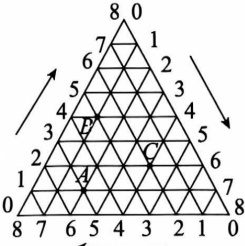

如图，将一等边三角形的三条边各 8 等分，按顺时针方向 (图中箭头方向) 标注各等分点的序号 0,1,2,3,4,5,6,7,8，将不同边上的序号和为 8 的两点依次连接起来，这样就建立了"三角形"坐标系. 在建立的"三角形"坐标系内，每一点的坐标用过这一点且平行 (或重合) 于原三角形三条边的直线与三边交点的序号来表示 (水平方向开始，按顺时针方向)，如点 A 的坐标可表示为 (1,2,5)，点 B 的坐标可表示为 (4,1,3)，按此方法，则点 C 的坐标可表示为 ___ .

> [!question]- 点击查看答案与解析
> 【答案】$(5, 4, 3)$
> 
> 【考点】三角形坐标系 → [[【初中数学知识点体系-人教版】#9-1 用坐标描述平面内点的位置]]
> 
> 【解析】根据给出的坐标定义方式及观察图示，遵循题目要求的按顺时针方向及序号和为 8 的规律得出点 C 的坐标为 $(5, 4, 3)$。
> 
> 【易错点】不能准确理解三角形坐标系的定义规则，混淆三个坐标分量与三条边的对应关系
