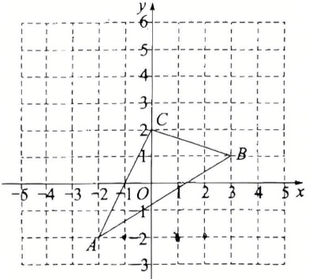

如图，在平面直角坐标系 xOy 中，三角形 ABC 三个顶点的坐标分别为 $(-2, -2)$， $(3, 1)$， $(0, 2)$，将三角形 ABC 向上平移 3 个单位长度，再向左平移 1 个单位长度，得到三角形 $A^{\prime}B^{\prime}C^{\prime}$。点 A，B，C 的对应点分别为 $A^{\prime}$， $B^{\prime}$， $C^{\prime}$。

(1) 写出点 $A^{\prime},B^{\prime},C^{\prime}$ 的坐标；
(2) 在图中画出平移后的三角形 $A^{\prime}B^{\prime}C^{\prime}$;
(3) 三角形 $A^{\prime}B^{\prime}C^{\prime}$ 的面积为 ___.

> [!question]- 点击查看答案与解析
> 【答案】(1) $A^{\prime}(-3, 1), B^{\prime}(2, 4), C^{\prime}(-1, 5)$；(3) $6.5$
> 
> 【考点】平移与坐标 → [[【初中数学知识点体系-人教版】#9-2 坐标方法的简单应用]]
> 
> 【解析】
> (1) 原坐标 $A(-2, -2), B(3, 1), C(0, 2)$。平移规律：横坐标 $-1$，纵坐标 $+3$。$A^{\prime}(-2-1, -2+3)=(-3, 1)$，$B^{\prime}(3-1, 1+2+1)=(2, 4)$，$C^{\prime}(0-1, 2+3)=(-1, 5)$。
> (3) 平移不改变图形面积。原三角形可用割补法求出面积为 $6.5$。
> 
> 【易错点】平移时横纵坐标变化方向搞混，或计算时正负号出错
