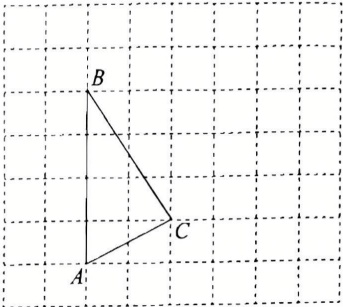

在平面直角坐标系 xOy 中，三角形的三个顶点坐标分别是 $A(0, -2)$，$B(0, 2)$，$C(2, -1)$.

(1) 在所给的图中,画出这个平面直角坐标系;
(2) 点 A 经过平移后的对应点为 $D(3,-1)$，将三角形 ABC 作同样的平移得到三角形 DEF，点 B, C 对应点分别是点 E, F，画出平移后的三角形 DEF；
(3) 在 (2) 的条件下,点 P 在 x 轴上,若三角形 PDE 的面积等于三角形 DEF 的面积,直接写出点 P 的坐标.

> [!question]- 点击查看答案与解析
> 【答案】(3) $(1, 0)$ 或 $(5, 0)$
> 
> 【考点】坐标系画图与面积 → [[【初中数学知识点体系-人教版】#9-2 坐标方法的简单应用]]
> 
> 【解析】
> (1) 略。(2) $A(0, -2)$ 到 $D(3, -1)$ 是右移 3，上移 1。三角形 DEF 各点：$D(3, -1), E(3, 3), F(5, 0)$。(3) 三角形 DEF 底 ED 为 4（纵坐标 $3-(-1)=4$），高为 2（横坐标 $5-3=2$）。面积为 $4$。P 在 x 轴上设 $P(x, 0)$，三角形 PDE 以 ED 为底（4），P 到直线 ED（即直线 $x=3$）的距离为 $|x-3|$。由面积相等得 $\frac{1}{2} \times 4 \times |x-3| = 4$，即 $|x-3|=2$，$x=1$ 或 $x=5$。
> 
> 【易错点】求点 P 到直线 ED 的距离时，未正确识别 ED 所在直线为 $x=3$，导致距离计算错误
