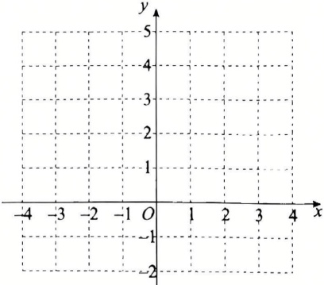

在平面直角坐标系 xOy 中，对于任意两点 $M(x_{1}, y_{1})$，$N(x_{2}, y_{2})$，定义 $k|x_{1}-x_{2}|+(1-k)|y_{1}-y_{2}|$ 为点 M 和点 N 的“k 阶距离”，其中 $0 \leqslant k \leqslant 1$。例如：点 $M(1,3)$，$N(-2,4)$ 的“ $\frac{1}{5}$ 阶距离”为 $\frac{1}{5}|1-(-2)|+\frac{4}{5}|3-4|=\frac{7}{5}$。已知点 $A(-1,2)$。

(1) 若点 $B(0,4)$，求点 A 和点 B 的“ $\frac{1}{4}$ 阶距离”；
(2) 若点 B 在 x 轴上，且点 A 和点 B 的“ $\frac{1}{3}$”阶距离”为 4，求点 B 的坐标；
(3) 若点 $B(a,b)$，且点 A 和点 B 的“ $\frac{1}{2}$ 阶距离”为 1，直接写出 $a+b$ 的取值范围.

备用图 

> [!question]- 点击查看答案与解析
> 【答案】(1) $\frac{7}{4}$；(2) $(7, 0)$ 或 $(-9, 0)$；(3) $-1 \leqslant a+b \leqslant 3$
> 
> 【考点】新定义距离 → [[【初中数学知识点体系-人教版】#9-1 用坐标描述平面内点的位置]]
> 
> 【解析】
> (1) 已知 $A(-1,2)$，$B(0,4)$，$k=\frac{1}{4}$，根据定义：
> $$\text{"}\frac{1}{4}\text{阶距离"} = \frac{1}{4}|-1-0| + \frac{3}{4}|2-4| = \frac{1}{4} \times 1 + \frac{3}{4} \times 2 = \frac{7}{4}$$
> 
> (2) 设 $B(x,0)$，$k=\frac{1}{3}$，根据定义：
> $$\frac{1}{3}|-1-x| + \frac{2}{3} \times 2 = 4 \Rightarrow |x+1| = 8 \Rightarrow x=7 \text{ 或 } x=-9$$
> 因此点 B 的坐标为 $(7,0)$ 或 $(-9,0)$。
> 
> (3) 已知 $A(-1,2)$，$B(a,b)$，$k=\frac{1}{2}$，根据定义：
> $$\frac{1}{2}|a+1| + \frac{1}{2}|b-2| = 1 \Rightarrow |a+1| + |b-2| = 2$$
> 令 $m=a+1$，$n=b-2$，则 $|m|+|n|=2$，$a+b=m+n+1$。
> 由 $|m+n| \leqslant |m|+|n|=2$，得 $-2 \leqslant m+n \leqslant 2$，即 $-1 \leqslant a+b \leqslant 3$。
> 
> 【易错点】新定义运算理解不到位，尤其是第 (3) 问利用绝对值不等式求取值范围时，容易忽略等号成立的条件
