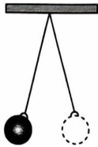

如图，一根细线上端固定，下端系一个小重物，让这个小重物来回自由摆动，来回摆动一次所用的时间 $t$（单位：s）与细线的长度 $l$（单位：m）之间满足关系 $t = 2\pi \sqrt{\frac{l}{10}}$。当细线的长度为 $0.9 \, m$ 时，小重物来回摆动一次所用的时间为 ___ s。（$\pi$ 取 3）

> [!question]- 点击查看答案与解析
> 【答案】$1.8$
> 
> 【考点】二次根式的运算、代入求值 → [[【初中数学知识点体系-人教版】#8-1 平方根]]
> 
> 【解析】
> 将 $l=0.9$，$\pi=3$ 代入公式 $t=2\pi\sqrt{\frac{l}{10}}$：
> $t=2\times3\times\sqrt{\frac{0.9}{10}}=6\times\sqrt{0.09}=6\times0.3=1.8$（s）
> 
> 【易错点】$\sqrt{0.09}$ 计算错误，或忘记 $\pi$ 取 3 而保留 $\pi$。
