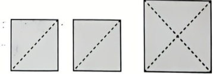

如图, 小宇利用两个面积为 $1 \, dm^2$ 的正方形拼成了一个面积为 $2 \, dm^2$ 的大正方形, 并通过测量大正方形的边长感受了 $\sqrt{2} \, dm$ 的大小. 为了感知更多无理数的大小, 小宇利用类似拼正方形的方法进行了很多尝试, 下列做法不能实现的是().

(A) 利用两个边长为 2 dm 的正方形感知 $\sqrt{8}$ dm 的大小
(B) 利用四个直角边长为 3 dm 的等腰直角三角形感知 $\sqrt{18}$ dm 的大小
(C) 利用一个边长为 $\sqrt{2}$ dm 的正方形以及一个直角边长为 2 dm 的等腰直角三角形感知 $\sqrt{6}$ dm 的大小
(D) 利用四个直角边长分别为 1 dm 和 3 dm 的直角三角形以及一个边长为 2 dm 的正方形感知 $\sqrt{10}$ dm 的大小

> [!question]- 点击查看答案与解析
> 【答案】C
> 
> 【考点】面积与边长的关系、图形拼接 → [[【初中数学知识点体系-人教版】#8-3 实数及其简单运算]]
> 
> 【解析】
> - 选项 A：两个边长为 2 dm 的正方形，面积各为 $4\ \text{dm}^2$，总面积 $8\ \text{dm}^2$，可拼成面积为 $8\ \text{dm}^2$ 的正方形，边长为 $\sqrt{8}$ dm，可行
> - 选项 B：四个直角边长为 3 dm 的等腰直角三角形，每个面积 $\frac{1}{2}\times3\times3=4.5\ \text{dm}^2$，总面积 $18\ \text{dm}^2$，可拼成面积为 $18\ \text{dm}^2$ 的正方形，边长为 $\sqrt{18}$ dm，可行
> - 选项 C：边长为 $\sqrt{2}$ dm 的正方形面积为 $2\ \text{dm}^2$，直角边长为 2 dm 的等腰直角三角形面积为 $2\ \text{dm}^2$，总面积 $4\ \text{dm}^2$，拼成的正方形边长为 2 dm，不是 $\sqrt{6}$ dm，不可行
> - 选项 D：四个直角边长分别为 1 dm 和 3 dm 的直角三角形，每个面积 $\frac{1}{2}\times1\times3=1.5\ \text{dm}^2$，总面积 $6\ \text{dm}^2$，加上边长为 2 dm 的正方形面积 $4\ \text{dm}^2$，总面积 $10\ \text{dm}^2$，可拼成面积为 $10\ \text{dm}^2$ 的正方形，边长为 $\sqrt{10}$ dm，可行
> 
> 不能实现的是 C。
> 
> 【易错点】面积计算错误，或不理解通过面积求边长的原理。
