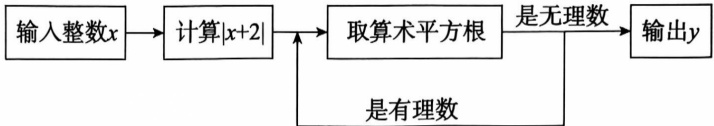

一个数值转化器, 如图所示:

(1) 当输入的 x 为 -18 时，求输出 y 的值；

(2) 若输入 x 后,始终不能输出 y,请写出所有满足要求的 x 的值,并说明你的理由;

(3) 若输出 y 的值是 $\sqrt{3}$，请写出两个满足要求的 x 的值.

> [!question]- 点击查看答案与解析
> 【答案】(1) $3\sqrt{2}$；(2) $x=0$；(3) $x=-3$ 或 $x=3$
> 
> 【考点】数值转化器的理解、算术平方根、无理数 → [[【初中数学知识点体系-人教版】#8-3 实数及其简单运算]]
> 
> 【解析】
> 
> 根据转化器流程：输入 $x$ $\rightarrow$ 若 $x<0$ 则取相反数，若 $x\geqslant 0$ 则直接取算术平方根 $\rightarrow$ 若结果为无理数则输出，若为有理数则返回取算术平方根步骤
> 
> (1) 输入 $x=-18$：
> - $-18<0$，先取相反数：$-(-18)=18$
> - 取算术平方根：$\sqrt{18}=\sqrt{9\times2}=3\sqrt{2}$
> - $3\sqrt{2}$ 是无理数，输出 $y=3\sqrt{2}$
> 
> (2) 始终不能输出 $y$，说明每次都得到有理数，进入死循环
> 当 $x=0$ 时：
> - $0\geqslant 0$，直接取算术平方根：$\sqrt{0}=0$（有理数）
> - 返回继续取算术平方根：$\sqrt{0}=0$（有理数）
> - 无限循环，始终不能输出
> 
> 所以 $x=0$。
> 
> (3) 输出 $y=\sqrt{3}$，说明算术平方根的结果是 $\sqrt{3}$
> 设取算术平方根前的数为 $m$，则 $\sqrt{m}=\sqrt{3}$，$m=3$
> 
> 情况一：输入 $x<0$，取相反数后得 3，所以 $-x=3$，$x=-3$
> 验证：$x=-3<0$，取相反数得 3，$\sqrt{3}$ 是无理数，输出 $\sqrt{3}$ ✓
> 
> 情况二：输入 $x\geqslant 0$，直接取算术平方根得 $\sqrt{3}$，所以 $x=3$
> 验证：$x=3\geqslant 0$，$\sqrt{3}$ 是无理数，输出 $\sqrt{3}$ ✓
> 
> 所以满足要求的 $x$ 值为 $-3$ 或 $3$。
> 
> 【易错点】不理解转化器的工作流程；忽略"有理数则循环"的条件；对不能输出的情况考虑不全面。
