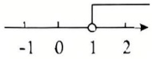
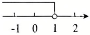
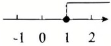
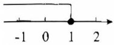

不等式 $x>1$ 的解集在数轴上表示正确的是( ).

A.

B.

C.

D.

> [!question]- 点击查看答案与解析
> **【答案】** B
> 
> **【考点】** 在数轴上表示不等式的解集 [[【初中数学知识点体系-人教版】#11-2 一元一次不等式]]
> 
> **【解析】**
> 不等式 $x>1$ 的解集在数轴上表示时，$1$ 处应为空心圆圈（不包含 $1$），方向向右（大于）。
> - 选项A：实心圆圈，表示 $x\geqslant1$，错误；
> - 选项B：空心圆圈向右，正确表示 $x>1$；
> - 选项C：空心圆圈向左，表示 $x<1$，错误；
> - 选项D：实心圆圈向左，表示 $x\leqslant1$，错误。
> 
> **【易错点】** 混淆空心与实心的含义：空心表示不包含该点，实心表示包含；混淆方向：大于向右，小于向左。
