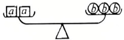
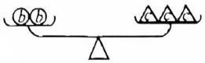

根据下图，对 a, b, c 三种物体质量的判断中正确的是 ( ).

A. $a<c$

B. $a<b$

C. $a>c$

D. $b<c$

> [!question]- 点击查看答案与解析
> **【答案】** C
> 
> **【考点】** 利用不等式比较大小、天平与不等式的对应关系 [[【初中数学知识点体系-人教版】#11-1 不等式]]
> 
> **【解析】**
> 由第一幅天平图（左边 $2$ 个 $a$ 重于右边 $1$ 个 $b$ 加 $1$ 个 $c$）得：$2a>b+c$，
> 由第二幅天平图（左边 $3$ 个 $b$ 重于右边 $1$ 个 $a$ 加 $1$ 个 $c$）得：$3b>a+c$。
> 两式相加得 $2a+3b>a+b+2c$，即 $a+2b>2c$。
> 由 $2a>b+c$ 知 $a>\frac{b+c}{2}$，即 $a$ 大于 $b$ 和 $c$ 的平均值，可判断 $a>c$。
> - 选项A：$a<c$，由上述推理可知 $a>c$，故此项错误；
> - 选项B：$a<b$，错误，从两图可判断 $a$ 大于 $b$；
> - 选项C：$a>c$，正确；
> - 选项D：$b<c$，无法确定 $b$ 与 $c$ 的大小关系，错误。
> 
> **【易错点】** 从天平图中正确列出不等式是关键，注意天平下沉的一边质量更大。
