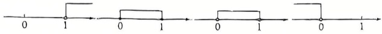

已知点 $P(a-1,-a)$ 在平面直角坐标系中的第四象限，则 a 的取值范围在数轴上的表示为

> [!question]- 点击查看答案与解析
> **【答案】** $a>1$，对应数轴上开口圆圈在 $1$ 处、向右延伸的选项
> 
> **【考点】** 平面直角坐标系中象限 [[【初中数学知识点体系-人教版】#9-1 用坐标描述平面内点的位置]]
> 
> **【解析】**
> 点 $P(a-1,-a)$ 在第四象限，第四象限的坐标特征为：横坐标 $>0$，纵坐标 $<0$。
> 列不等式组：$\begin{cases} a-1>0 \\ -a<0 \end{cases}$，
> 解 $a-1>0$ 得 $a>1$；解 $-a<0$ 得 $a>0$。
> 取交集得 $a>1$。
> 在数轴上表示为：在 $1$ 处画开口圆圈，向右方向画线表示 $a>1$。
> 
> **【易错点】** 混淆各象限的坐标符号规律（第四象限应为 $(+,-)$）；解 $-a<0$ 时忘记改变不等号方向。
