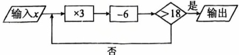

运行程序如图 11-Z-3 所示，从“输入实数 x”到“结果是否>18”为一次程序操作。若输入 x 后程序操作进行了两次后输出，则 x 的取值范围是 ___ .

图 11-Z-3 

> [!question]- 点击查看答案与解析
> **【答案】** $\frac{14}{3} < x \leqslant 8$
> 
> **【考点】** 程序流程图与不等式组 [[【初中数学知识点体系-人教版】#11-3 一元一次不等式组]]
> 
> **【解析】**
> 分析程序流程图可知，一次操作为：输入 $x$ $→$ 乘以 $3$ $→$ 减去 $6$ $→$ 判断结果是否 $> 18$。若结果 $> 18$ 则停止输出，否则将结果作为新输入继续操作。
> 操作进行了两次后输出，说明：
> 第一次操作后结果 $\leqslant 18$（未停止）：$3x - 6 \leqslant 18$，解得 $x \leqslant 8$；
> 第二次操作后结果 $> 18$（停止）：以 $3x-6$ 为新输入，$3(3x-6) - 6 > 18$，即 $9x - 24 > 18$，$9x > 42$，解得 $x > \frac{14}{3}$。
> 综上，$x$ 的取值范围为 $\frac{14}{3} < x \leqslant 8$。
> 
> **【易错点】** 不理解"两次后输出"对应的两个不等关系（第一次不停止、第二次停止）；第二次操作时忘记用第一次的运算结果作为新输入；解 $9x - 24 > 18$ 时移项或系数化 $1$ 出错。
