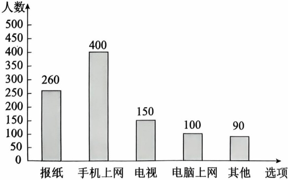

如图是某市电视台记者为了解市民获取新闻的主要途径，通过抽样调查绘制的一个条形统计图。若该市约有 230 万人，则可估计其中将报纸和手机上网作为获取新闻的主要途径的总人数大约为 ___ 万人。

> [!question]- 点击查看答案与解析
> **【答案】** 根据条形图中报纸和手机上网人数之和占总调查人数的比例乘以230万计算得出
> 
> **【考点】** 条形统计图的应用，用样本估计总体 [[【初中数学知识点体系-人教版】#12-2 用统计图描述数据]]
> 
> **【解析】**
> 从条形统计图中分别读取报纸和手机上网作为获取新闻主要途径的人数，将两者相加，除以总调查人数，得到报纸和手机上网人数占总人数的比例，再用该比例乘以该市总人口230万，即可估计出全市将报纸和手机上网作为获取新闻主要途径的总人数。
> 
> **【易错点】** 漏加某类人数；总调查人数读取错误
