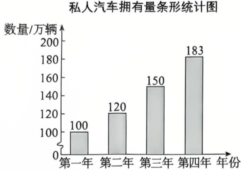
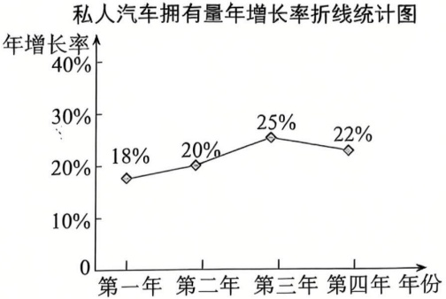

下列是某市所统计的四年私人汽车拥有量和年增长率统计图. 该市第四年私人汽车拥有量比前一年增加了 ___ 万辆, 私人汽车拥有量年增长率最大的是第 ___ 年.

> [!question]- 点击查看答案与解析
> **【答案】** 根据条形图计算第4年与第3年拥有量之差；根据折线图找出年增长率最高的年份
> 
> **【考点】** 条形统计图和折线统计图的综合应用 [[【初中数学知识点体系-人教版】#12-2 用统计图描述数据]]
> 
> **【解析】**
> 第一空：从条形统计图中分别读出第4年和第3年的私人汽车拥有量（单位：万辆），用第4年拥有量减去第3年拥有量，即得增加的数量。
> 第二空：从折线统计图中观察各年的年增长率折线，找出最高点对应的年份，即为私人汽车拥有量年增长率最大的年份。
> 
> **【易错点】** 误将拥有量当作增长率；计算增长量时用错年份顺序
