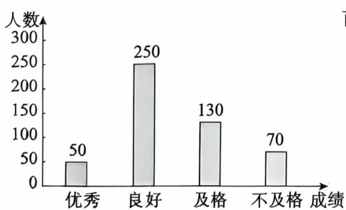
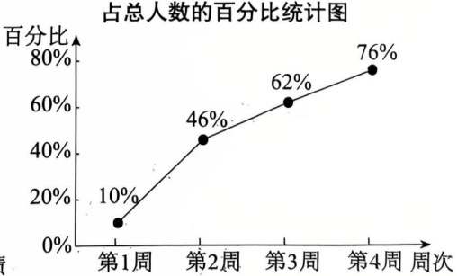

某校连续 4 周开展了“垃圾分类我知道”的知识问答测试活动，并将测试成绩整理、绘制成如下所示的统计图。（第 1～4 周参与测试的学生人数不变）

第1周全体学生测试成绩统计图 

第1~4周测试成绩“优秀”的学生人数 

由图得出如下三个推断：

$①$ 每周有 500 名学生参与测试；

$②$ 从第 1 周到第 4 周，测试成绩“优秀”的学生人数在总人数中的占比逐周增长，且第 2 周增长最多；

$③$ 第 4 周测试成绩“优秀”的学生人数达到 400 人.

其中,合理的推断的序号是 ( ).

A. $①②$

B. $①③$

C. $②③$

D. $①②③$

> [!question]- 点击查看答案与解析
> **【答案】** B（$①③$）
> 
> **【考点】** 扇形统计图与折线统计图的综合分析 [[【初中数学知识点体系-人教版】#12-2 用统计图描述数据]]
> 
> **【解析】**
> - 选项A（$①②$）：包含错误的$②$，排除；
> - 选项B（$①③$）：$①$和$③$均正确，故B正确；
> - 选项C（$②③$）：包含错误的$②$，排除；
> - 选项D（$①②③$）：包含错误的$②$，排除。
> 
> 推断分析：
> - $①$：第1周扇形图中优秀占20%，折线图中第1周优秀人数为100人，则总人数为 $100 \div 20\% = 500$ 人，且每周参与测试人数不变，故$①$正确；
> - $②$：各周优秀人数分别为100、200、300、400，各周占比分别为 $20\%$、$40\%$、$60\%$、$80\%$，每周增长均为20个百分点，增长量相同，并非第2周增长最多，故$②$错误；
> - $③$：从折线图中可读出第4周优秀人数为400人，故$③$正确。
> 
> 因此合理的推断是 $①$ 和 $③$，选B。
> 
> **【易错点】** 误判"第2周增长最多"——需计算每周占比的实际增长量而非仅看人数增长
