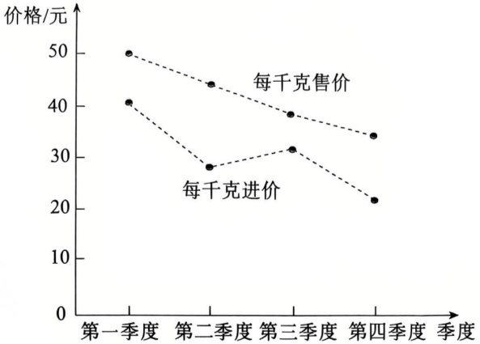

在一年的四个季度中, 某种水产品的每千克进价与售价的信息如图所示, 则出售该种水产品每千克利润最大的季度是 ( ).

A. 第一季度

B. 第二季度

C. 第三季度

D. 第四季度

> [!question]- 点击查看答案与解析
> **【答案】** 根据各季度利润（售价-进价）大小判断，利润最大的季度即为答案
> 
> **【考点】** 折线统计图的读图分析，利润计算 [[【初中数学知识点体系-人教版】#12-2 用统计图描述数据]]
> 
> **【解析】**
> 利润 = 每千克售价 - 每千克进价。从折线图中分别读出四个季度的每千克进价和每千克售价，分别计算各季度利润：
> - 第一季度利润 = 第一季度售价 - 第一季度进价
> - 第二季度利润 = 第二季度售价 - 第二季度进价
> - 第三季度利润 = 第三季度售价 - 第三季度进价
> - 第四季度利润 = 第四季度售价 - 第四季度进价
> 
> 比较四个季度的利润，找出利润最大的季度。
> 
> **【易错点】** 混淆进价与售价，用错减法顺序；读图时看错对应折线
