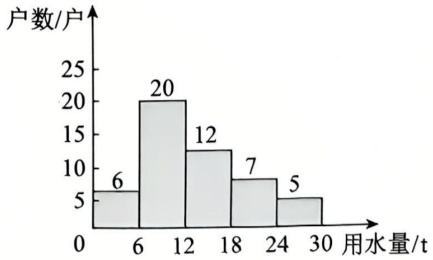

为提高居民的节水意识，某小区开展了以“建设节水型社区，保障用水安全”为主题的节水宣传活动，小明同学积极参与小区的宣传活动，并对小区 300 户家庭的用水情况进行了抽样调查。他在 300 户家庭中，随机调查了 50 户家庭 5 月份的用水量情况，结果如图所示（每组数据包含最大值，不含最小值）。

(1) 试估计该小区 5 月份用水量不高于 12 t 的户数；

(2) 把图中每组用水量的值用该组的中间值 (如 0~6 的中间值为 3) 来替代, 估计该小区 5 月份的用水量.

> [!question]- 点击查看答案与解析
> **【答案】**
> (1) 根据直方图中用水量不高于12t的户数占样本的比例乘以300户估算
> (2) 用各组中间值乘以对应频数求总用水量，再除以样本户数，最后乘以300户估算
> 
> **【考点】** 频数分布直方图的应用，用样本估计总体 [[【初中数学知识点体系-人教版】#12-2 用统计图描述数据]]
> 
> **【解析】**
> (1) 从直方图中分别读取用水量在 $0\sim6$ t和 $6\sim12$ t的户数（频数），相加得到用水量不高于12t的户数，除以样本总数50户，得到比例，再乘以小区总户数300户，即得估计值。
> (2) 用各组的中间值（组中值）代替该组每户的用水量：
> - $0\sim6$ t组：中间值为3，频数为$a$
> - $6\sim12$ t组：中间值为9，频数为$b$
> - $12\sim18$ t组：中间值为15，频数为$c$
> - $18\sim24$ t组：中间值为21，频数为$d$
> - $24\sim30$ t组：中间值为27，频数为$e$
> 
> 样本总用水量 $= 3a + 9b + 15c + 21d + 27e$，样本户均用水量 $= \frac{3a + 9b + 15c + 21d + 27e}{50}$，该小区5月份总用水量估计为 $\frac{3a + 9b + 15c + 21d + 27e}{50} \times 300$（单位：t）。
> 
> **【易错点】** (1) 遗漏"不高于12t"包含 $0\sim6$ t和 $6\sim12$ t两组；(2) 组中值取错（应为两端平均值）；直接用样本总量代替总体总量而未考虑户数差异
