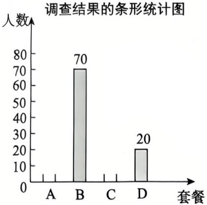
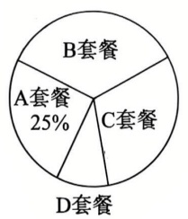

某中学食堂为全校 1000 名学生提供了 A, B, C, D 四种套餐，为了解学生对这四种套餐的喜好情况，学校随机抽取 200 名学生进行了“你最喜欢哪一种套餐（必选且只选一种）”问卷调查。根据调查结果绘制了条形统计图和扇形统计图，部分信息如下：

**调查结果的扇形统计图**

(1) 求在抽取的 200 人中最喜欢 A 套餐的人数；

(2) 求扇形统计图中 C 套餐对应扇形的圆心角度数；

(3) 补全条形统计图；

(4) 依据本次调查结果,估计全校 1000 名学生中最喜欢 C 套餐的人数.

> [!question]- 点击查看答案与解析
> **【答案】**
> (1) 最喜欢A套餐人数 $= 200 - (B\text{人数} + C\text{人数} + D\text{人数})$
> (2) C套餐圆心角 $= \frac{C\text{人数}}{200} \times 360^\circ$
> (3) 补全条形图见解析
> (4) 全校最喜欢C套餐人数 $= 1000 \times \frac{C\text{人数}}{200}$
> 
> **【考点】** 条形统计图与扇形统计图的综合应用，样本估计总体 [[【初中数学知识点体系-人教版】#12-2 用统计图描述数据]]
> 
> **【解析】**
> (1) 由条形统计图读出B、C、D套餐的人数，则最喜欢A套餐的人数 $= 200 - (B\text{人数} + C\text{人数} + D\text{人数})$。
> (2) 扇形统计图中C套餐对应扇形的圆心角度数 $= \frac{C\text{套餐人数}}{200} \times 360^\circ$。
> (3) 补全条形统计图：根据第(1)问求出的A套餐人数，在条形图中将A套餐对应的条形补充完整，确保其高度与人数一致。
> (4) 用样本中喜欢C套餐的比例估计全校：$1000 \times \frac{C\text{人数}}{200}$。
> 
> **【易错点】** (1) 总人数误用1000而不是200；(2) 圆心角公式中忘记乘以 $360^\circ$；(3) 补全时条形高度不准确
