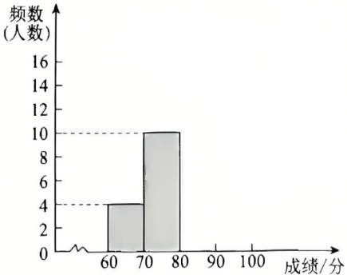

为弘扬传统文化，某校开展了“传承传统文化，阅读经典名著”活动，并举行了经典名著知识竞赛。为了解七年级学生（七年级有8个班，共320名学生）的阅读效果，综合实践调查小组开展了一次调查研究。

**收集数据**

(1) 调查小组计划选取 40 名学生的竞赛成绩(百分制)作为样本,下面的抽样方法中,合理的是 ___ ;(填字母)

A. 抽取七年级1班、2 班各 20 名学生的竞赛成绩组成样本

B. 抽取各班竞赛成绩较好的共 40 名学生的竞赛成绩组成样本

C. 从年级中按学号随机选取 40 名学生的竞赛成绩组成样本

**整理、描述数据**

抽样方法确定后，调查小组收集到了 40 名学生的竞赛成绩，其中竞赛成绩 $x$ 在 $80 \leqslant x \leqslant 100$ 范围的具体成绩如下：

| 90 | 92 | 81 | 82 | 95 | 86 | 88 | 89 | 86 | 93 | 97 | 100 | 80 |
|---|---|---|---|---|---|---|---|---|---|---|---|---|
| 81 | 86 | 89 | 82 | 85 | 98 | 90 | 97 | 100 | 84 | 87 | 92 | 96 |

整理数据,得到如下频数分布表和频数分布直方图(不完整):

| 成绩 | 频数 |
|---|---|
| 60≤x&lt;70 | 4 |
| 70≤x&lt;80 |  |
| 80≤x&lt;90 |  |
| 90≤x≤100 |  |

(2) 请补全以上频数分布表和频数分布直方图；

**应用数据**

(3) 若竞赛成绩不低于 90 分的记为"优秀"，请你估计参加这次知识竞赛的全年级 320 名学生中，竞赛成绩为"优秀"的约有多少人？

> [!question]- 点击查看答案与解析
> **【答案】**
> (1) C
> (2) 频数分布表：$70 \leqslant x < 80$ 为10人，$80 \leqslant x < 90$ 为14人，$90 \leqslant x \leqslant 100$ 为12人
> (3) 约96人
> 
> **【考点】** 抽样方法的合理性，频数分布表与频数分布直方图，用样本估计总体 [[【初中数学知识点体系-人教版】#12-1 统计调查]]
> 
> **【解析】**
> (1) 抽样调查要求样本具有代表性和随机性：
> - 选项A：只抽取七年级1班和2班，样本不具有代表性，不合理；
> - 选项B：只抽取成绩较好的学生，样本有偏，不能代表全年级水平，不合理；
> - 选项C：按学号随机选取，保证了随机性和代表性，合理。
> 
> 故选择C。
> 
> (2) 补全频数分布表：
> 已知总人数为40人，$60 \leqslant x < 70$ 组有4人。
> $80 \leqslant x \leqslant 100$ 范围内的26个数据中：
> - $80 \leqslant x < 90$：81, 82, 86, 88, 89, 86, 80, 81, 86, 89, 82, 85, 84, 87，共14人
> - $90 \leqslant x \leqslant 100$：90, 92, 95, 93, 97, 100, 98, 90, 97, 100, 92, 96，共12人
> 
> 则 $70 \leqslant x < 80$ 组人数 $= 40 - 4 - 14 - 12 = 10$ 人。
> 
> 补全频数分布表：
> | 成绩 | 频数 |
> | --- | --- |
> | $60 \leqslant x < 70$ | 4 |
> | $70 \leqslant x < 80$ | 10 |
> | $80 \leqslant x < 90$ | 14 |
> | $90 \leqslant x \leqslant 100$ | 12 |
> 
> 频数分布直方图按以上频数补全即可。
> 
> (3) 样本中竞赛成绩不低于90分（优秀）的有12人，占样本比例 $\frac{12}{40} = 30\%$。估计全年级320人中优秀人数为 $320 \times 30\% = 96$ 人。
> 
> **【易错点】** (1) 忽略抽样的随机性和代表性要求；(2) 频数统计时重复计数或遗漏；(3) 估计总体时直接用样本人数乘以总人数，而非先求比例
