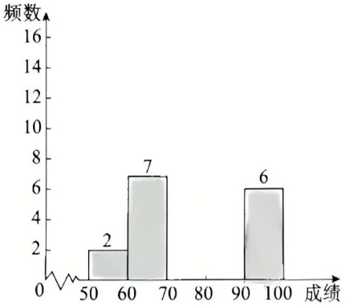

《北京市生活垃圾管理条例》将生活垃圾分为厨余垃圾、可回收物、有害垃圾以及其他垃圾四类。为了促使七年级学生更好地了解垃圾分类知识，某学校在七年级随机抽取了 40 名学生进行垃圾分类知识测试。将测试成绩作为样本，得到了如下信息：

a. 垃圾分类知识测试成绩频数分布表

| 成绩分组 | 50≤x&lt;60 | 60≤x&lt;70 | 70≤x&lt;80 | 80≤x&lt;90 | 90≤x&lt;100 |
|---|---|---|---|---|---|
| 频数 | 2 | 7 | m | 10 | 6 |

b. 垃圾分类知识测试成绩频数分布直方图

c. 成绩在 $80 \leqslant x < 90$ 这一组的成绩为：80, 82, 83, 84, 85, 86, 87, 88, 89, 89. 根据以上信息，回答下列问题：

(1) 本次抽样调查样本容量为 ___ ，表中 $m$ 的值为 ___ ；

(2) 请补全频数分布直方图；

(3) 若测试成绩不低于 85 分记为"优秀"，该学校七年级共有 300 名学生，请你估计该学校七年级测试成绩为"优秀"的学生人数约为 ___ 人.

> [!question]- 点击查看答案与解析
> **【答案】**
> (1) 样本容量为40，$m = 15$
> (2) 补全直方图：将 $70 \leqslant x < 80$ 组的条形补至高度为15
> (3) 约90人
> 
> **【考点】** 频数分布表与频数分布直方图，样本估计总体 [[【初中数学知识点体系-人教版】#12-1 统计调查]]
> 
> **【解析】**
> (1) 由题意知，样本容量为40。频数分布表中各组频数之和为40：
> $2 + 7 + m + 10 + 6 = 40$，解得 $m = 40 - 2 - 7 - 10 - 6 = 15$。
> 即 $70 \leqslant x < 80$ 组有15人。
> 
> (2) 补全频数分布直方图：在直方图中将 $70 \leqslant x < 80$ 这一组的条形补充完整，使其高度对应频数15。
> 
> (3) 成绩不低于85分记为"优秀"。
> 在 $80 \leqslant x < 90$ 组中，成绩为80, 82, 83, 84, 85, 86, 87, 88, 89, 89，其中 $\geqslant 85$ 的有85, 86, 87, 88, 89, 89，共6人。
> 在 $90 \leqslant x < 100$ 组中有6人，全部 $\geqslant 85$ 分。
> 则样本中优秀人数为 $6 + 6 = 12$ 人，优秀比例为 $\frac{12}{40} = 30\%$。
> 估计全年级300人中优秀人数为 $300 \times 30\% = 90$ 人。
> 
> **【易错点】** (1) 计算 $m$ 时漏加某个频数；(2) 统计优秀人数时，$80 \leqslant x < 90$ 组中低于85分的成绩不应计入；(3) 用样本估计总体时忘记乘以总人数
