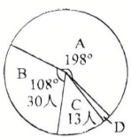

某数学学习小组为了解本校同学日常“垃圾分类”投放情况，随机从本校同学中抽取部分同学进行调查，并将调查到的数据绘制成如图12 Z-1所示的扇形图，其中 A: 每次分类投放，B: 经常分类投放，C: 有时分类投放，D: 从不分类投放，则下列说法中错误的是

图 12-Z-1 

A. 此次共随机调查了 200 名同学

B. 选择“每次分类投放”垃圾的同学有 55 人

C. 选择“有时分类投放”垃圾所在扇形圆心角的度数为 46.8°

D. 选择"从不分类投放"垃圾的同学所占百分比为 2%

> [!question]- 点击查看答案与解析
> **【答案】** C
> 
> **【考点】** 扇形图百分比与圆心角 [[【初中数学知识点体系-人教版】#12-2 用统计图描述数据]]
> 
> **【解析】**
> - 选项A：从扇形图可知，A（每次分类投放）的圆心角为 $99\degree$，占比为 $99\degree/360\degree=27.5\%$，对应55人，则总人数为 $55\div27.5\%=200$，说法正确；
> - 选项B：由A选项分析可知，选择"每次分类投放"的同学有55人，说法正确；
> - 选项C：从扇形图可知，C（有时分类投放）占 $26\%$，对应的圆心角应为 $360\degree\times26\%=93.6\degree$，而非 $46.8\degree$，说法错误；
> - 选项D：从扇形图可知，D（从不分类投放）占 $2\%$，说法正确。
> 
> **【易错点】** 计算圆心角时百分比与角度换算错误，将 $93.6\degree$ 误算为 $46.8\degree$。
