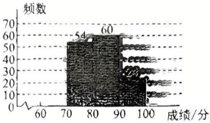

为增强学生网络常识及安全意识，某校举行了一次全校 6000 名学生参加的安全知识竞赛，从中随机抽取 150 名学生的竞赛成绩进行分析，把成绩（满分100分，所有竞赛成绩均不低于60分）分成四个等级 $(60\leqslant x<70;70\leqslant x<80;80\leqslant x<90;90\leqslant x\leqslant100)$，并根据分析结果绘制了如图12-Z-2所示不完整的频数分布直方图.请据此估计全校学生中竞赛成绩低于80分的人数是

图 12-7-2 

A. 2160

B. 2640

C. 3000

D. 3360

> [!question]- 点击查看答案与解析
> **【答案】** B
> 
> **【考点】** 频数分布直方图 [[【初中数学知识点体系-人教版】#12-2 用统计图描述数据]]
> 
> **【解析】**
> 从频数分布直方图可知，随机抽取的150名学生中：
> - 等级 $60\leqslant x<70$ 有24人；
> - 等级 $70\leqslant x<80$ 有42人。
> 低于80分（即 $60\leqslant x<80$）的人数为 $24+42=66$（人），
> 占样本的比例为 $\dfrac{66}{150}=0.44=44\%$。
> 全校6000名学生中，估计竞赛成绩低于80分的人数为 $6000\times44\%=2640$（人）。
> - 选项A：2160，对应样本中低于80分占比36%（54人），错误；
> - 选项B：2640，对应占比44%（66人），正确；
> - 选项C：3000，对应占比50%（75人），错误；
> - 选项D：3360，对应占比56%（84人），错误。
> 
> **【易错点】** 读直方图时频数统计错误，或计算百分比后乘以全校总人数时出错。
