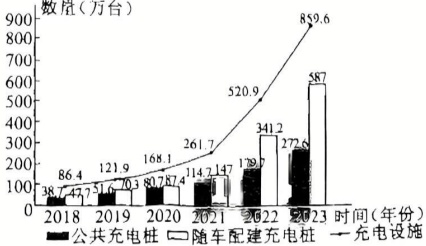

（2024海淀区期末）近年来，汽车工业不断进行技术改革和升级，新能源汽车走进千家万户，与之配套的充电设施也在不断建设中。从充电设施的应用场景看，充电设施可分为私人随车配建充电桩和公共充电桩。据新能源汽车国家大数据联盟统计，2018—2023年我国充电设施累计数量情况如图12-Z-3所示。

图 12-Z-3 

根据上述信息，给出下列四个结论：

$①$ 2018—2023年，每年充电设施累计数量呈上升趋势；

$②$ 2023年新增公共充电桩数量超过90万台；

$③$ 2018—2023年，每年新增的随车配建充电桩数量逐年上升；

$④$ 2018—2023年，随车配建充电桩累计数量占充电设施累计数量的百分比最高的年份是2023年.

其中所有正确的结论是

A. $②③$

B. $①②④$

C. $①②③$

D. $①③④$

> [!question]- 点击查看答案与解析
> **【答案】** B
> 
> **【考点】** 统计图的综合分析 [[【初中数学知识点体系-人教版】#12-2 用统计图描述数据]]
> 
> **【解析】**
> 逐条分析四个结论：
> - $①$ 2018—2023年，每年充电设施累计数量呈上升趋势。从图12-Z-3的折线图可知，各年累计数量持续增加，$①$ 正确；
> - $②$ 2023年新增公共充电桩数量超过90万台。从图中数据计算，2023年公共充电桩累计数量减去2022年累计数量，差值超过90万台，$②$ 正确；
> - $③$ 2018—2023年，每年新增的随车配建充电桩数量逐年上升。从图中看，新增数量并非逐年持续上升，中间年份存在波动，$③$ 错误；
> - $④$ 2018—2023年，随车配建充电桩累计数量占充电设施累计数量的百分比最高的年份是2023年。从图中两类数据对比可知，随车配建占比逐年提高，2023年达到最高，$④$ 正确。
> 综上，正确的结论是 $①②④$。
> - 选项A：$②③$，漏了 $①④$ 且 $③$ 错误，错误；
> - 选项B：$①②④$，三个正确结论均包含，正确；
> - 选项C：$①②③$，$③$ 错误，错误；
> - 选项D：$①③④$，$③$ 错误，错误。
> 
> **【易错点】** 对"逐年上升"的理解——需检查每一年是否都比上一年增加，有下降则结论不成立。
