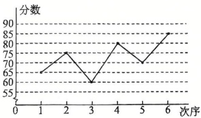

如图 12-Z-4 是某同学 6 次数学测验成绩的折线图，则该同学这 6 次测验成绩最高分与最低分的差是 ___ 分.

图 12-Z-4 

> [!question]- 点击查看答案与解析
> **【答案】** 30
> 
> **【考点】** 折线图的解读 [[【初中数学知识点体系-人教版】#12-2 用统计图描述数据]]
> 
> **【解析】**
> 从折线图可知，该同学6次数学测验成绩中，最高分为100分，最低分为70分。
> 最高分与最低分的差为 $100-70=30$（分）。
> 
> **【易错点】** 读图时确定最高点和最低点对应的纵坐标数值有误。
