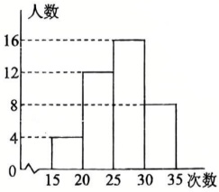

为了解某校八年级学生的体能情况，学校随机抽查了其中的 40 名学生，测试他们一分钟仰卧起坐的次数，并绘制成如图 12-Z-5 所示的频数分布直方图，则一分钟仰卧起坐的次数在 20～30 之间的频率是 ___ .

图 12-Z-5 

> [!question]- 点击查看答案与解析
> **【答案】** 0.3
> 
> **【考点】** 频率的计算 [[【初中数学知识点体系-人教版】#12-1 统计调查]]
> 
> **【解析】**
> 从频数分布直方图可知，一分钟仰卧起坐次数在20～30之间的频数为12。
> 被抽查的学生总数为40人，频率 $=\dfrac{\text{频数}}{\text{总数}}=\dfrac{12}{40}=0.3$。
> 
> **【易错点】** 频率的计算公式误用，或将频率与频数混淆。
