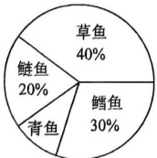

如图 12-Z-6 是某水产养殖户根据鱼塘里饲养鱼苗的种类绘制的扇形图，已知该鱼塘饲养草鱼 240 条，则饲养青鱼的数量为 ___ 条.

图 12-Z-6 

> [!question]- 点击查看答案与解析
> **【答案】** 120
> 
> **【考点】** 扇形图的解读 [[【初中数学知识点体系-人教版】#12-2 用统计图描述数据]]
> 
> **【解析】**
> 从扇形图可知，草鱼占 $40\%$，青鱼占 $20\%$。
> 草鱼有240条，则鱼塘中鱼苗总数为 $240\div40\%=600$（条）。
> 青鱼数量为 $600\times20\%=120$（条）。
> 
> **【易错点】** 先求总数时除法计算错误，或青鱼百分比读图有误。
