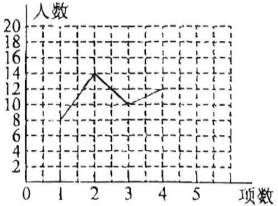
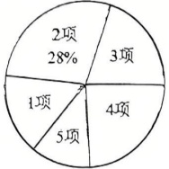

（14分)为响应“学雷锋、树新风、做文明中学生”的号召，某校开展了志愿者服务活动，活动项目有“戒毒宣传”“文明交通岗”“关爱老人”“义务植树”“社区服务”五项，活动期间，随机抽取了部分学生对志愿者服务情况进行调查.结果发现，被调查的每名学生都参与了活动，最少的参与了 1 项，最多的参与了 5 项，根据调查结果绘制了如图12-Z-7所示不完整的折线图和扇形图.

(1) (4 分)被随机抽取的学生共有___ 人；

(2) (4分)在扇形图中,参与了3项活动的学生所对应的扇形圆心角的度数为___；

(3) (6分)该校共有学生2000人,估计其中参与了4项或5项活动的学生共有多少人.

学生参与志愿者活动情况的折线图 

学生参与志愿者活动情况的扇形图 

图 12-2-7 

> [!question]- 点击查看答案与解析
> **【答案】** (1) 200； (2) $108\degree$； (3) 800人
> 
> **【考点】** 折线图和扇形图的综合分析 [[【初中数学知识点体系-人教版】#12-2 用统计图描述数据]]
> 
> **【解析】**
> (1) 从折线图可知参与1项至5项活动的人数分别为20、40、60、50、30，
> 被随机抽取的学生总数为 $20+40+60+50+30=200$（人）。
> 
> (2) 参与了3项活动的学生有60人，占被调查总人数的比例为 $\dfrac{60}{200}=0.3=30\%$，
> 对应的扇形圆心角度数为 $360\degree\times30\%=108\degree$。
> 
> (3) 参与了4项活动的学生有50人，参与了5项活动的学生有30人，
> 参与4项或5项活动的学生共 $50+30=80$（人），
> 占样本的比例为 $\dfrac{80}{200}=0.4=40\%$。
> 该校共有学生2000人，估计参与了4项或5项活动的学生人数为 $2000\times40\%=800$（人）。
> 
> **【易错点】** 扇形圆心角计算时忘记乘以 $360\degree$；估计总体时忘记乘以全校总人数。
