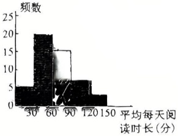

（15分）（2024西城区期末）在世界读书日来临之际，某校数学活动小组为了解七年级学生每天阅读时长的情况设计了一份调查问卷，同时随机邀请七年级的一些学生完成调查问卷，获得了这些学生平均每天阅读时长（单位：分）的数据，并对这些数据进行整理，绘制成频数分布表、频数分布直方图。下面给出了部分信息。

A. 平均每天阅读时长频数分布表、频数分布直方图分别如下：

| 分组 | 频数 |
|---|---|
| 0≤x&lt;30 | m |
| 30≤x&lt;60 | 20 |
| 60≤x&lt;90 | n |
| 90≤x&lt;120 | 7 |
| 120≤x≤150 | 3 |

图 12-乙-8 

B. 其中 $60\leqslant x<90$ 这一组的平均每天阅读时长是：60, 60, 70, 70, 73, 75, 75, 75, 80, 83, 84, 84, 84, 85, 89.

根据以上信息，回答下列问题：

(1) (6分)表中m=___，n=___，参与问卷调查的学生共有___ 人；

(2) (4 分)补全频数分布直方图;

(3) (5分)为了鼓励学生养成阅读习惯,语文老师建议对七年级平均每天阅读时长在 75 分钟及以上的学生授予"阅读达人"称号.已知七年级共有 990 名学生,请估计该年级共有多少名学生获得"阅读达人"称号.

> [!question]- 点击查看答案与解析
> **【答案】** (1) $m=10$，$n=15$，参与问卷调查的学生共有55人； (2) 见解析； (3) 360人
> 
> **【考点】** 频数分布表与直方图的综合分析 [[【初中数学知识点体系-人教版】#12-1 统计调查]]
> 
> **【解析】**
> (1) 根据B条件，$60\leqslant x<90$ 这一组的数据共有15个，因此 $n=15$。
> 从频数分布直方图可知，$0\leqslant x<30$ 这一组的频数为10，因此 $m=10$。
> 参与问卷调查的学生总数为 $m+20+n+7+3=10+20+15+7+3=55$（人）。
> 
> (2) 补全频数分布直方图：
> - $0\leqslant x<30$：10人（已画）；
> - $30\leqslant x<60$：20人（已画）；
> - $60\leqslant x<90$：15人（需补画高度为15的长方形）；
> - $90\leqslant x<120$：7人（已画）；
> - $120\leqslant x\leqslant150$：3人（已画）。
> 
> (3) 平均每天阅读时长在75分钟及以上的学生：
> 在 $60\leqslant x<90$ 组中，数据为60, 60, 70, 70, 73, 75, 75, 75, 80, 83, 84, 84, 84, 85, 89，
> 其中 $\geqslant75$ 的有75, 75, 75, 80, 83, 84, 84, 84, 85, 89，共10人；
> $90\leqslant x<120$ 组有7人，$120\leqslant x\leqslant150$ 组有3人，
> 共计 $10+7+3=20$（人）。
> 占样本的比例为 $\dfrac{20}{55}$。
> 七年级共有990名学生，估计获得"阅读达人"称号的人数为 $990\times\dfrac{20}{55}=990\times\dfrac{4}{11}=360$（人）。
> 
> **【易错点】** 在 $60\leqslant x<90$ 组中筛选 $\geqslant75$ 的数据时漏数或多数；计算 $990\times\dfrac{20}{55}$ 时约分错误。
