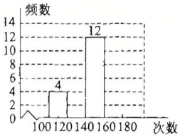
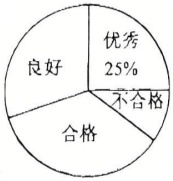

（18分)促进青少年健康成长是实施“健康中国”战略的重要内容.为了引导学生积极参与体育运动，某校举办了一分钟跳绳比赛，随机抽取了 40 名学生一分钟跳绳的次数进行调查统计，并根据调查统计的结果绘制了如下表格和统计图：

| 等级 | 次数 | 百分比 |
|---|---|---|
| 不合格 | 100≤x&lt;120 | a |
| 合格 | 120≤x&lt;140 | b |
| 良好 | 140≤x&lt;160 |  |
| 优秀 | 160≤x&lt;180 |  |

图 12-Z-9 

请结合上述信息回答下列问题：

(1) (4 分)a=___ ，b=___ ；

(2) (4 分)请补全频数分布直方图；

(3) (4分)在扇形图中，“良好”等级对应的扇形圆心角的度数是 ___ ；

(4) (6分)若该校有 2000 名学生,根据抽样调查的结果,请估计该校学生一分钟跳绳次数达到合格及以上的人数.

> [!question]- 点击查看答案与解析
> **【答案】** (1) $a=10$，$b=30$； (2) 见解析； (3) $144\degree$； (4) 1800人
> 
> **【考点】** 频数分布直方图与扇形图的综合分析 [[【初中数学知识点体系-人教版】#12-2 用统计图描述数据]]
> 
> **【解析】**
> (1) 从频数分布直方图和扇形图可知，被调查的40名学生中：
> 不合格等级（$100\leqslant x<120$）有4人，占比 $\dfrac{4}{40}=0.1=10\%$，$a=10$；
> 合格等级（$120\leqslant x<140$）有12人，占比 $\dfrac{12}{40}=0.3=30\%$，$b=30$。
> 
> (2) 补全频数分布直方图：
> - 良好等级（$140\leqslant x<160$）有16人，需补画高度为16的长方形；
> - 优秀等级（$160\leqslant x<180$）有8人，需补画高度为8的长方形。
> 
> (3) "良好"等级对应的学生人数为16人，占样本比例为 $\dfrac{16}{40}=0.4=40\%$，
> 对应的扇形圆心角度数为 $360\degree\times40\%=144\degree$。
> 
> (4) 一分钟跳绳次数达到合格及以上的人数为 $12+16+8=36$（人），
> 占样本比例为 $\dfrac{36}{40}=0.9=90\%$。
> 该校有2000名学生，估计达到合格及以上的人数为 $2000\times90\%=1800$（人）。
> 
> **【易错点】** 计算圆心角时忘记乘以 $360\degree$；"合格及以上"包括合格、良好、优秀三个等级，容易漏算。
