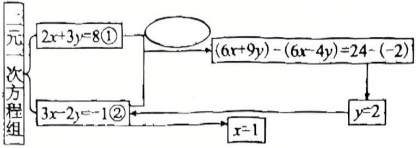

解方程组 $\begin{cases}2x+3y=8,\\ 3x-2y=-1\end{cases}$ 的思路可用如图 10-Z-1 所示的框图表示，图中应填写地对方程 $①②$ 所做的变形为

图 10-Z-1 

A. $①×2+②×3$

B. $①×2-②×3$

C. $①×3-②×2$

D. $①×3+②×2$

> [!question]- 点击查看答案与解析
> 【答案】A
>
> 【考点】加减消元法 → [[【初中数学知识点体系-人教版】#10-2 消元——解二元一次方程组]]
>
> 【解析】
> 方程组$\begin{cases}2x+3y=8①\\3x-2y=-1②\end{cases}$，目标消去$y$：
> - 选项A：$①×2+②×3$，$y$的系数化为$6$和$-6$，可消去$y$，正确；
> - 选项B：$①×2-②×3$，无法消元，错误；
> - 选项C：$①×3-②×2$，消去$x$，非题目目标，错误；
> - 选项D：$①×3+②×2$，无法消元，错误。
>
> 【易错点】混淆消元目标（消$x$/$y$）；系数配平错误。
