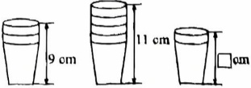

如图 10-Z-2, 大小相同的杯子叠放在一起. 根据图中的信息, “□”处应填 ___ .

图 10-2-2 

> [!question]- 点击查看答案与解析
> 【答案】26
>
> 【考点】方程组应用（叠杯子） → [[【初中数学知识点体系-人教版】#10-3 实际问题与二元一次方程组]]
>
> 【解析】
> 设杯高$h$，每叠一个增加$d$，$\begin{cases}h+d=14\\h+2d=16\end{cases}$，解得$h=12，d=2$，8个杯高$=12+2×7=26$。
>
> 【易错点】未考虑杯子叠加的高度规律；方程组列错。
