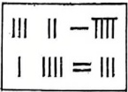
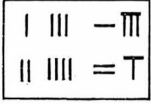

**(新情境数学文化)** 如图 10-2-3 是《九章算术》中的算筹图，图中各行从左到右列出的算筹数分别表示未知数 x，y 的系数与相应的常数项。如图 $①$ 所示的算筹图用方程组形式表述出来，就是 $\begin{cases}3x+2y=19,\\ x+4y=23.\end{cases}$ 类似地，图 $②$ 所示的算筹图用方程组形式表述为 ___ ，它的解是 ___

$①$

$②$ 

图 10-2-3 

> [!question]- 点击查看答案与解析
> 【答案】$\begin{cases}2x+3y=14,\\ 4x+5y=29\end{cases}$；$\begin{cases}x=\frac{17}{2},\\ y=-1\end{cases}$
> 
> 【考点】数学文化《九章算术》算筹图的理解、解二元一次方程组 → [[【初中数学知识点体系-人教版】#10-2 消元——解二元一次方程组]]
> 
> 【解析】
> 根据图 $①$ 的规律：第一行表示 $x$ 的系数、$y$ 的系数、常数项。
> 
> 图 $②$：第一行算筹数为 $2$、$3$、$14$，表示 $2x+3y=14$
> 
> 第二行算筹数为 $4$、$5$、$29$，表示 $4x+5y=29$
> 
> $\therefore$ 方程组为 $\begin{cases}2x+3y=14,\\ 4x+5y=29\end{cases}$
> 
> $①\times2$：$4x+6y=28$ $③$
> 
> $③-②$：$(4x+6y)-(4x+5y)=28-29$
> 
> $y=-1$
> 
> 代入 $①$：$2x+3\times(-1)=14$
> 
> $2x=17$，$x=\frac{17}{2}$
> 
> 验证：$4\times\frac{17}{2}+5\times(-1)=34-5=29$ ✓
> 
> $\therefore$ 方程组的解为 $\begin{cases}x=\frac{17}{2},\\ y=-1\end{cases}$
> 
> 【易错点】理解算筹图时需要正确识别每行算筹数分别代表的含义，解方程组时计算过程容易出错。
