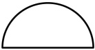
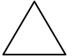
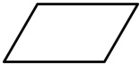
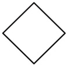

1. 下列图形中，既是轴对称图形又是中心对称图形的是（）

A.

B. 

C. 

D. 

> [!question]- 点击查看答案与解析
> 【答案】B
> 
> 【考点】轴对称图形、中心对称图形的判断 → [[【初中数学知识点体系-人教版】#15-1 图形的轴对称]]
> 
> 【解析】
> 轴对称图形是沿某条直线对折后两部分完全重合的图形；中心对称图形是绕某点旋转180°后与原图重合的图形。逐一判断各选项：选项A仅为轴对称图形；选项B既是轴对称图形又是中心对称图形；选项C仅为轴对称图形；选项D既不是轴对称图形也不是中心对称图形。
> 
> 【易错点】混淆轴对称与中心对称的判定条件，需同时满足两个条件。
