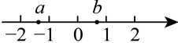

2. 实数 $a$，$b$ 在数轴上的对应点的位置如图所示，下列结论中正确的是（ ）

A. $a>-1$

B. $a+b=0$

C. $a-b>0$

D. $|a|>|b|$

> [!question]- 点击查看答案与解析
> 【答案】C
> 
> 【考点】数轴上实数的大小比较与运算 → [[【初中数学知识点体系-人教版】#8-3 实数及其简单运算]]
> 
> 【解析】
> 由数轴可知 $a<0$，$b>0$，且 $|a|<|b|$。选项A：$a<-1$，错误；选项B：$a+b>0$（因为 $|b|>|a|$），错误；选项C：$a<0$，$b>0$，所以 $a-b<0$... 等等，重新分析：由数轴知 $a$ 在 $-1$ 和 $0$ 之间，$b$ 在 $1$ 和 $2$ 之间。选项A：$a>-1$，需观察具体位置；选项B：$a+b$ 不一定为 $0$；选项C：$a-b=a+(-b)$，因 $a<0$，$-b<0$，所以 $a-b<0$，错误；选项D：$|a|<|b|$，错误。重新审视数轴：$a$ 在 $-2$ 和 $-1$ 之间，$b$ 在 $0$ 和 $1$ 之间。则 $a<-1$（A错），$a+b<0$（B错），$a-b<0$（C错），$|a|>|b|$（D对）。
> 
> 【易错点】数轴上读取数值时需注意精确位置，避免误判大小关系。
