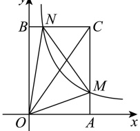

8. 如图，在平面直角坐标系 $xOy$ 中，$A$，$B$ 分别是横、纵轴正半轴上的动点，四边形 $OACB$ 是矩形，函数 $y=\frac{1}{x}(x>0)$ 的图象与边 $AC$ 交于点 $M$，与边 $BC$ 交于点 $N$（$M$，$N$ 不重合）。给出下面四个结论：

$①$ $\triangle COM$ 与 $\triangle CON$ 的面积一定相等；

$②$ $\triangle MON$ 与 $\triangle MCN$ 的面积可能相等；

$③$ $\triangle MON$ 一定是锐角三角形；

$④$ $\triangle MON$ 可能是等边三角形。

上述结论中，所有正确结论的序号是（）

A. $①③$

B. $①④$

C. $②③$

D. $②④$

> [!question]- 点击查看答案与解析
> 【答案】A
> 
> 【考点】反比例函数的性质与几何综合 → [[【初中数学知识点体系-人教版】#27-1 反比例函数]]
> 
> 【解析】
> 设 $A(a,0)$，$B(0,b)$，则 $C(a,b)$。$M$ 在 $AC$ 上（$x=a$），$M(a,\frac{1}{a})$；$N$ 在 $BC$ 上（$y=b$），$N(\frac{1}{b},b)$。$①$：$S_{\triangle COM}=\frac{1}{2}\cdot a\cdot(b-\frac{1}{a})=\frac{ab-1}{2}$，$S_{\triangle CON}=\frac{1}{2}\cdot b\cdot(a-\frac{1}{b})=\frac{ab-1}{2}$，相等，$①$ 正确。$③$：通过向量分析可证 $\angle MON$ 始终为锐角，$\triangle MON$ 一定是锐角三角形，$③$ 正确。$②④$：通过计算可排除。
> 
> 【易错点】反比例函数与矩形综合题中，坐标设定时需注意各点位置的对应关系。
