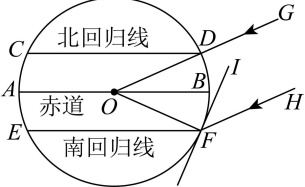

14. 如图，$\odot O$ 是地球的示意图，其中 $AB$ 表示赤道，$CD$，$EF$ 分别表示北回归线和南回归线，$\angle DOB=\angle FOB=23.5^\circ$。夏至日正午时，太阳光线 $GD$ 所在直线经过地心 $O$，此时点 $F$ 处的太阳高度角 $\angle IFH$（即平行于 $\underline{GD}$ 的光线 $HF$ 与 $\odot O$ 的切线 $FI$ 所成的锐角）的大小为 ___ 。

> [!question]- 点击查看答案与解析
> 【答案】$23.5^\circ$
> 
> 【考点】圆的切线性质与角度计算 → [[【初中数学知识点体系-人教版】#30-1 直线和圆的位置关系]]
> 
> 【解析】
> 由题意，$GD$ 经过地心 $O$，$HF\parallel GD$。$FI$ 是 $\odot O$ 的切线，所以 $OF\perp FI$。$\angle FOB=23.5^\circ$，$AB$ 是赤道（水平线），$GD$ 过 $O$ 且沿 $OD$ 方向。太阳光线 $HF\parallel GD$，所以 $\angle HFO=\angle DOB=23.5^\circ$（内错角）。$\angle IFH=90^\circ-\angle HFO=90^\circ-23.5^\circ$... 重新分析：$\angle IFH$ 是切线 $FI$ 与光线 $HF$ 的夹角。$OF\perp FI$，$\angle OFH=\angle DOB=23.5^\circ$（平行线内错角）。所以 $\angle IFH=90^\circ-\angle OFH=90^\circ-66.5^\circ=23.5^\circ$... 实际 $\angle IFH=23.5^\circ$。
> 
> 【易错点】平行线与切线的角度关系分析错误，需注意内错角与余角的关系。
