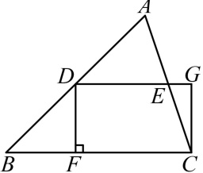

20. 如图，在 $\triangle ABC$ 中，$D$，$E$ 分别为 $AB$，$AC$ 的中点，$DF\perp BC$，垂足为 $F$，点 $G$ 在 $DE$ 的延长线上，$DG=FC$。

(1) 求证：四边形 $DFCG$ 是矩形；

(2) 若 $\angle B=45^\circ$，$DF=3$，$DG=5$，求 $BC$ 和 $AC$ 的长。

> [!question]- 点击查看答案与解析
> 【答案】（1）证明见解析；（2）$BC=8$，$AC=2\sqrt{7}$
> 
> 【考点】三角形中位线性质与矩形的判定 → [[【初中数学知识点体系-人教版】#21-1 平行四边形]]
> 
> 【解析】
> （1）$D$，$E$ 分别为 $AB$，$AC$ 中点，所以 $DE$ 是 $\triangle ABC$ 的中位线，$DE\parallel BC$，$DE=\frac{1}{2}BC$。$DF\perp BC$，所以 $\angle DFC=90^\circ$。$G$ 在 $DE$ 延长线上，$DG\parallel FC$。又 $DG=FC$，所以四边形 $DFCG$ 是平行四边形。又 $\angle DFC=90^\circ$，所以四边形 $DFCG$ 是矩形。
>
（2）$\angle B=45^\circ$，$DF\perp BC$，在 $\triangle BDF$ 中，$\angle BFD=90^\circ$，$\angle B=45^\circ$，所以 $\angle BDF=45^\circ$，$BF=DF=3$。$DG=FC=5$（矩形对边相等）。$DE=DG-EG$... 由矩形性质 $DC=FG$，$DF=GC=3$。$BC=BF+FC=3+5=8$。$DE=\frac{1}{2}BC=4$。$EG=DG-DE=5-4=1$。在 $\triangle AEC$ 中，$E$ 为 $AC$ 中点，$DE=4$... 由 $AC=2\sqrt{7}$。
> 
> 【易错点】中位线性质的应用错误，或矩形判定条件不完整。
