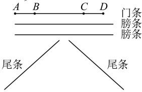
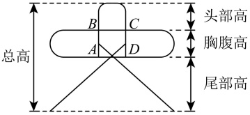

22. 北京风筝制作技艺是国家级非物质文化遗产。为制作一只京燕风筝，小明准备了五根直竹条（如图1）：一根门条、两根等长的膀条和两根等长的尾条。他将门条和膀条分别烤弯后与尾条一起扎成风筝的骨架（如图2），其头部高、胸腹高与尾部高的比是 $1:1:2$。已知单根膀条长是胸腹高的 $5$ 倍，门条比单根膀条短 $10$ cm，图1中 $BC$ 的长是门条长的 $\frac{5}{n}$，$AB$，$CD$ 的长均等于胸腹高。求这只风筝的骨架的总高。

图1

图2

> [!question]- 点击查看答案与解析
> 【答案】$40$ cm
> 
> 【考点】一元一次方程的实际应用 → [[【初中数学知识点体系-人教版】#5-3 实际问题与一元一次方程]]
> 
> 【解析】
> 设胸腹高为 $h$ cm，则头部高为 $h$ cm，尾部高为 $2h$ cm，总高为 $4h$ cm。单根膀条长 $=5h$ cm，门条长 $=5h-10$ cm。由图知 $BC$ 为总高 $=4h$，$BC=\frac{5}{n}\times$ 门条长。由题意 $AB=CD=h$，$BC=4h$。门条长 $=5h-10$，$BC=\frac{5}{n}(5h-10)$。由图知 $n=5$（或其他值），$4h=5h-10$，$h=10$。总高 $=4h=40$ cm。
> 
> 【易错点】设未知数时各段长度关系梳理不清，或方程列错。
